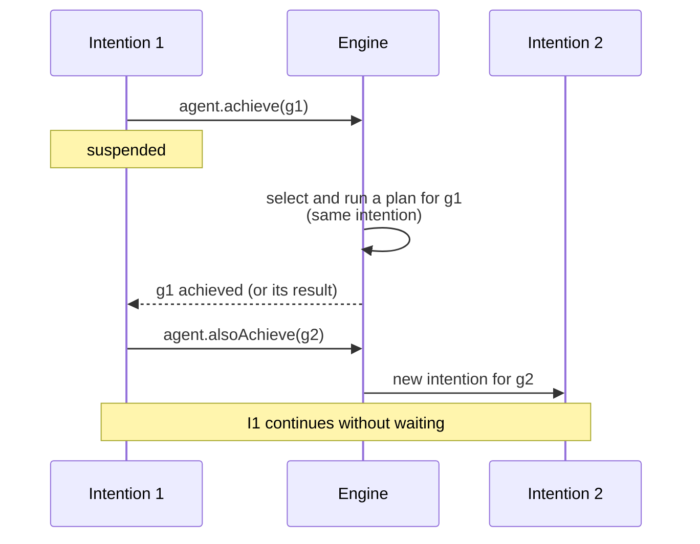

import Tabs from '@theme/Tabs';
import TabItem from '@theme/TabItem';

# Goals

Goals are the objectives an agent aims to achieve: they stand for the desires of the [BDI](./bdi.mdx) model.
Adding a goal generates an event that selects a relevant
[plan](./plans.md); executing that plan is an **intention**.

As for [beliefs](./beliefs.md), a goal can be any Kotlin type, and an [incarnation](../incarnations/index.md) can fix
a richer one: with the Prolog incarnation, a goal is a Prolog term.

## Initial goals

Initial goals are pursued as soon as the agent starts. Declare them with `hasInitialGoals { }` and `!`,
or add them one at a time with `addGoal(goal)` in the agent builder:

<Tabs groupId="incarnation" queryString>
  <TabItem value="kotlin" label="Kotlin" default>

The barista of the [sub-goals](../../how-to/sub-goals.md) example has goals of its own sealed type, `Task`:

```kotlin
agent<String, Task> {
    embodiedAs { Any() }
    hasInitialGoals {
        !Open
    }
}
```

  </TabItem>
  <TabItem value="prolog" label="Prolog">

```kotlin
agent<PrologBelief, PrologGoal, Any> {
    embodiedAs { Any() }
    hasInitialGoals {
        !initialGoal { "start"(0, 10) }
    }
}
```

  </TabItem>
</Tabs>

## Sub-goals

A plan body can pursue new goals in two ways:

- `agent.achieve(goal)` pursues a **sub-goal** within the current intention and *suspends* until the sub-goal
  has been achieved. If the sub-goal fails and no [failure plan](./plans.md#failure-plans) recovers it,
  the calling plan fails as well.
- `agent.alsoAchieve(goal)` adds a goal that is pursued by a **new, concurrent intention**; the current plan
  does not wait for it.



:::tip
Use `achieve` when the plan needs the sub-goal done (or its result) before going on, and `alsoAchieve` for an activity
that can proceed on its own. The how-to [Achieve sub-goals and recover from failures](../../how-to/sub-goals.md)
puts both to work.
:::

<Tabs groupId="incarnation" queryString>
  <TabItem value="kotlin" label="Kotlin" default>

Opening the café plays music in an intention of its own, and serves the two orders one after the other:

```kotlin
adding.goal { this as? Open } triggers {
    agent.alsoAchieve(PlayMusic)
    agent.achieve(Serve("espresso"))
    agent.achieve(Serve("cappuccino"))
    agent.print("All orders served")
}
```

  </TabItem>
  <TabItem value="prolog" label="Prolog">

Build the goal with `goal { }`, so that the variables bound by the plan's trigger are substituted in:

```kotlin
prologPlan {
    adding.goal {
        matchingGoal { "tower"(logicList(X, Y, tail = T)) }
    } triggers {
        agent.achieve(goal { "tower"(logicList(Y, tail = T)) })
        agent.achieve(goal { "on"(X, Y) })
    }
}
```

  </TabItem>
</Tabs>

## Goals with results

Plans are Kotlin functions, so they can return a value. `achieveWithResult` pursues a sub-goal and returns
the value produced by the plan that achieved it:

```kotlin
adding.goal { this as? Prepare } triggers {
    agent.achieve(Grind)
    "cup of ${context.coffee}"
}

adding.goal { this as? Serve } triggers {
    val cup: String = agent.achieveWithResult(Prepare(context.coffee))
    agent.print("Here is your $cup!")
}
```

The result type of a plan is the type of its body's last expression, and `achieveWithResult<R>` only selects plans
whose result type is a subtype of `R`, so a value of the wrong type never reaches the caller. The check is the same on
every platform, and it does not know the supertypes of your own classes: a plan ending with `Ok(x)` returns `Ok`,
and is not selected for `achieveWithResult<Outcome>`. Declare the wider type with `returns<Outcome>()` before
`triggers`, as described in the [DSL reference](../../reference/dsl.md#result-type).

## Why there are no test goals

AgentSpeak has a second kind of goal, the **test goal** `?g`, to retrieve information from the belief base: it
binds the variables of `g` to a matching belief, and if there is none it generates an event, so that a plan can
find the information some other way. JaKtA only has the goals described above, because a plan body is Kotlin code
with direct access to the agent's beliefs:

- to read a belief, the body inspects `agent.beliefs` directly, as any Kotlin collection, or with a query
  (`testQuery { }` in the Prolog incarnation);
- to obtain information the agent does not have yet, the body pursues a [goal with a result](#goals-with-results),
  whose plan computes it however it needs to.

The price is paid in communication: in Jason, a question from another agent is answered as a test goal, without
any plan, while a JaKtA agent needs a plan to answer it (see
[questions in KQML messaging](../incarnations/prolog/kqml.md#questions)).

## Failure

A goal fails when no plan is applicable for it, or when the plan pursuing it throws an exception.
The failure generates a new event, which `failing.goal { }` plans can handle — see [Plans](./plans.md#failure-plans).

If a failure plan handles it, whoever was waiting on the goal (e.g. an `agent.achieve(...)` call) resumes
with the result of the failure plan. If no failure plan is applicable, or the failure plan fails too,
the failure propagates to the waiting plan, and so on up the chain of sub-goals
(see [Failure handling](../execution-model.md#failure-handling) for the details).

### Failed intentions

Nobody waits for a goal added with `alsoAchieve` or as an initial goal, or for a plan reacting to a belief change:
if it fails and no failure plan recovers it, the whole **intention** has failed, with nobody left to handle it.
By default, the failure is logged as a warning. An agent can react to it with `handlesFailedIntentions`:

```kotlin
agent {
    handlesFailedIntentions {
        agent.print("Gave up on $goal: ${cause.message}")
        goal?.let { agent.alsoAchieve(it) }   // e.g. pursue the goal again
    }
}
```

The handler sees the **root goal** of the intention (`null` if it reacted to a belief change), not the deepest
sub-goal that failed, and the **original cause**: the exception of the plan that failed first, passed up unchanged.
It runs on an intention of its own, so it can use `agent` like a plan body: wait, pursue goals, change beliefs.
A failure inside the handler is only logged. A belief change no plan reacts to is not a failure.
