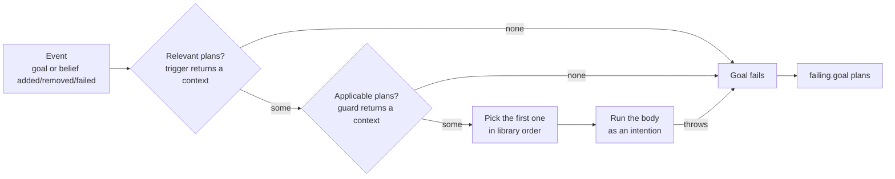

import Tabs from '@theme/Tabs';
import TabItem from '@theme/TabItem';

# Plans

Plans are the agent's know-how in the [BDI](./bdi.mdx) model: they define **how** it reacts to events, i.e. new
[goals](./goals.md), [belief](./beliefs.md) changes, and failures.
A plan is made of three parts:

```kotlin
adding.goal {
    // trigger
} onlyWhen {
    // guard (optional)
} triggers {
    // body
}
```

Plans are declared in `hasPlanLibrary { }`.

## Triggers

A trigger selects the kind of event and decides whether the plan is **relevant** for it:

| Trigger | Fires when |
|---|---|
| `adding.goal { }` | a goal is added |
| `failing.goal { }` | a goal fails |
| `removing.goal { }` | a goal is removed |
| `adding.belief { }` | a belief is added |
| `removing.belief { }` | a belief is removed |

The trigger block receives the goal or belief as `this` and returns either `null` (the plan is not relevant)
or a **context** value, which is then available to the guard and body as `context`:

```kotlin
adding.belief {
    takeIf { it.text == "Ping!" }
} triggers {
    val (text, sender) = context
    // ...
}
```

With goals of a sealed type, a cast is all a trigger needs: `adding.goal { this as? Serve }` is relevant for every
`Serve` goal, which becomes the context. Incarnations can provide matching helpers that build the context for you,
such as `matchingGoal { }` in the Prolog incarnation, where the context holds the variables bound by unification.

## Guards

`onlyWhen { }` makes a relevant plan **applicable** only if a condition holds in the current state.
It can read `beliefs` and `context`, and returns the (possibly refined) context or `null`.

<Tabs groupId="incarnation" queryString>
  <TabItem value="kotlin" label="Kotlin" default>

The [thermostat](../../tutorials/thermostat.md) heats a room that is too cold, unless it is heating already:

```kotlin
adding.belief {
    takeIf { it.temperature < it.target - TOLERANCE }
} onlyWhen {
    context.takeIf { it.mode != Mode.HEATING }
} triggers {
    agent.print("It's ${context.temperature}°C, heating up to ${context.target}°C")
    hvac.heat()
}
```

  </TabItem>
  <TabItem value="prolog" label="Prolog">

`satisfies { }` proves a query against the belief base, and adds its bindings to the context:

```kotlin
prologPlan {
    adding.goal {
        matchingGoal { "start"(N, X) }
    } onlyWhen {
        satisfies { (N lowerThan X) and (S `is` (N + 1)) }
    } triggers {
        agent.print("Counting... ", N)
        agent.achieve(goal { "start"(S, X) })
    }
}
```

  </TabItem>
</Tabs>

## Plan selection

A plan is **relevant** for an event when its trigger returns a context, and **applicable** when its guard returns one
too. When several plans are relevant, the first applicable one in the plan library is chosen:



If no plan is applicable, or the body throws, a goal [fails](./goals.md#failure), and `failing.goal` plans get a
chance to recover it. A belief event, or a goal removal, with no applicable plan is simply ignored: belief changes that
no plan cares about are normal.

:::tip
Since the first applicable plan wins, order your plans from the most specific to the most general: a catch-all plan
added first would shadow all the others. The [Blocks World showcase](../../showcase/blocksworld.md#plan-selection-by-context)
relies on this.
:::

## Bodies

The body, `triggers { }`, is a `suspend` Kotlin lambda. Anything Kotlin can do, a plan body can do:
call functions, use `delay(...)`, launch computations. Its receiver provides:

- `agent` — the agent's state: `believe`, `forget`, `beliefs`, `print`, the [sub-goal](./goals.md#sub-goals)
  functions `achieve`, `alsoAchieve` and `achieveWithResult`, and `wait(filter, timeout)` to suspend until a matching
  event happens (see [Wait for events and use time](../../how-to/wait-for-events.md));
- `node` — the [node](../nodes.md) the agent lives in (e.g. `node.terminateNode()`). It is not part of
  the plan scope: it comes from the enclosing `agent { }` / `node { }` builder, or from the `plans { node -> }` parameter;
- `context` — the value produced by the trigger and guard;
- any [skill](../interaction/acting.md) in scope.

:::info[A plan runs until it suspends]
In AgentSpeak and Jason, the reasoning cycle executes one step of a plan, e.g. one action, at a time. A JaKtA plan body
has no such steps: it runs without interruption until it **suspends** — on `achieve`, `delay`, `wait` or any other
`suspend` call — and the agent handles other events and intentions only then. Suspension points are the steps; see
[Intentions are coroutines](../execution-model.md#intentions-are-coroutines).
:::

:::info[With the Prolog incarnation]
`X.value<T>()` extracts the Kotlin value bound to a logic variable, e.g. `blocksWorld.move(X.value(), Y.value())`.
:::

## Failure plans

`failing.goal { }` plans handle goal [failures](./goals.md#failure), e.g. to retry after changing the agent's knowledge:

<Tabs groupId="incarnation" queryString>
  <TabItem value="kotlin" label="Kotlin" default>

When the barista cannot prepare a coffee, it buys beans and prepares it again; the cup it returns completes the
failed goal:

```kotlin
failing.goal { this as? Prepare } triggers {
    agent.print("I could not prepare the ${context.coffee}: buying beans and trying again")
    agent.believe("beans")
    val cup: String = agent.achieveWithResult(context)
    cup
}
```

  </TabItem>
  <TabItem value="prolog" label="Prolog">

```kotlin
prologPlan {
    failing.goal {
        matchingGoal { "start"(B) }
    } triggers {
        agent.print("start failed, retrying")
        agent.alsoAchieve(goal { "start"(B) })
    }
}
```

  </TabItem>
</Tabs>

## Reusable plan libraries

`plans { node -> ... }` builds a list of plans outside an agent, which can then be installed with
`withPredefinedPlans(...)`. The `node` parameter lets the plans use node-bound skills:

<Tabs groupId="incarnation" queryString>
  <TabItem value="kotlin" label="Kotlin" default>

```kotlin
val pingPlans = plans<ToldBelief, String, Any> { node ->
    context(MessagingSkill(node)) {
        adding.goal {
            takeIf { it == "start" }
        } triggers {
            agent.sendTo(bob, "Ping!")
        }
    }
}

agent(alice) {
    // ...
    withPredefinedPlans(pingPlans)
}
```

  </TabItem>
  <TabItem value="prolog" label="Prolog">

```kotlin
val pingPlans = plans { node ->
    context(MessagingSkill(node)) {
        prologPlan {
            adding.goal {
                matchingGoal { Atom.of("start") }
            } triggers {
                agent.tellTo(bob, belief { "ping"(1) })
            }
        }
    }
}

agent(alice) {
    // ...
    withPredefinedPlans(pingPlans)
}
```

  </TabItem>
</Tabs>
