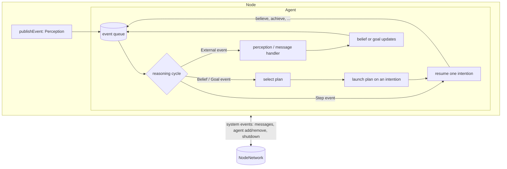
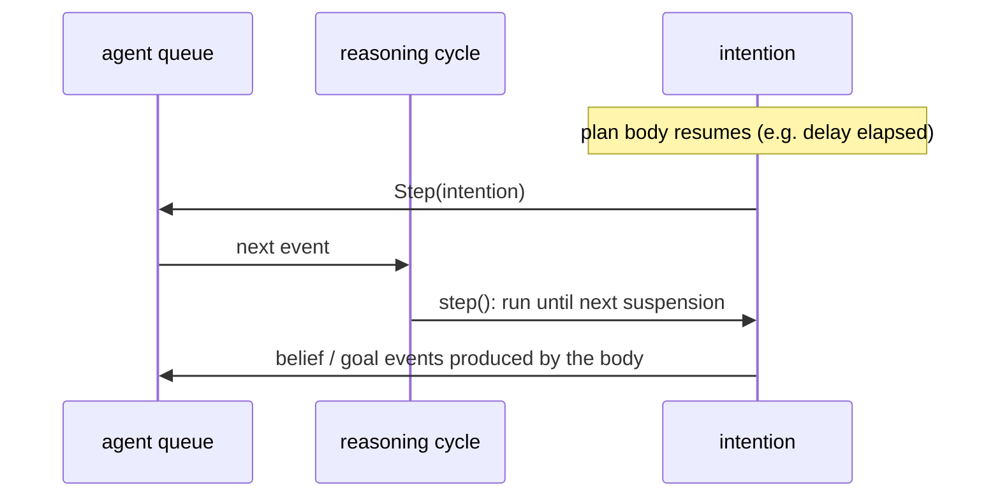

# The reasoning cycle

A BDI interpreter runs a **reasoning cycle**: it perceives, updates the beliefs, picks an event to handle, selects a
plan for it, and advances one of the agent's intentions. In Jason, every iteration of the cycle executes one step of
one intention, e.g. one action[^jason]. This page describes how JaKtA's engine (`jakta-core`) realises the cycle for
a single agent: an event-driven loop over one queue, where intentions are coroutines and their steps are suspension
points. Knowing it helps predict in which order things happen, and why plan bodies can freely suspend.
File references are to [`jakta-core`](https://github.com/jakta-bdi/jakta/tree/main/jakta-core/src/commonMain/kotlin/it/unibo/jakta)
and [`jakta-api`](https://github.com/jakta-bdi/jakta/tree/main/jakta-api/src/commonMain/kotlin/it/unibo/jakta);
how nodes run their agents is described in [Nodes](./nodes.md#how-nodes-run).

## Overview

## One queue per agent

Every agent (`BaseAgent.kt`) owns a **single FIFO event queue**. It is exposed as two inboxes:

- the **internal inbox**, where the agent itself posts belief events, goal events and intention steps;
- the **external inbox**, where the node delivers perceptions and messages.

Since both inboxes feed the same queue, events are handled in the order they were produced, whatever their origin.
For example, if a plan publishes a perception and then calls `agent.achieve(...)`, the perception is processed first,
so the beliefs are up to date when the plan for the new goal is selected.

When an agent is created, each initial goal is posted as if by `alsoAchieve`, i.e. each gets its own intention.
Initial beliefs are loaded without generating events.

## Handling an event

The node runner executes each agent in its own coroutine, looping on `BaseAgentLifecycle.step()`:
wait for the next event, handle it, yield. Handling an event (`BaseAgentLifecycle.kt`) means:

1. **Wake up waiters.** Every pending `agent.wait(filter, timeout)` whose filter matches the event is resumed.
2. **Dispatch** on the event type:
   - **External** (perception or message): call the agent's `handlesPerceptionEvents` / `handlesMessageEvents`
     handler. The resulting `AgentUpdate` is applied: beliefs are added/removed (which posts belief events),
     goals are posted as goal-addition/removal events. A `null` update ignores the event.
   - **Belief or goal event**: select the first relevant and applicable plan (`selectPlan`, see
     [Plan selection](./basic-concepts/plans.md#plan-selection)) and launch it. When the plan starts running, its
     trigger and guard are evaluated once more to build the context passed to the body (`Plan.run`).
   - **Step**: resume one intention (see [Intentions](#intentions-are-coroutines)).

The belief base (`BeliefBaseImpl.kt`) is a set: adding a belief it already has, or removing one it doesn't,
changes nothing and posts no event. When an `AgentUpdate.Belief` contains the same belief in both
additions and removals, it is ignored.

## Intentions are coroutines

A plan body is a `suspend` function, launched as a coroutine that belongs to an **intention**
(`BaseIntention.kt`, `BaseIntentionPool.kt`). Intentions are not scheduled by a thread pool.
Their coroutines run on an `IntentionDispatcher` (`jakta-api/.../intention/IntentionDispatcher.kt`), which does not run
a resumed continuation right away. Instead it:

1. enqueues the continuation in the intention;
2. posts a **Step** event for that intention in the agent's queue.

When the reasoning cycle reaches the Step event, it runs that continuation until the plan body suspends again,
e.g. on `achieve`, `delay`, `wait`, or any other suspending call.

As a consequence:

- **Agents are reactive while plans suspend.** During a `delay(...)` or while waiting for a sub-goal, the agent keeps
  processing perceptions, messages and other intentions.
- **Intentions interleave step by step.** Between two suspension points a plan body runs without interruption, and
  the agent's intentions never run in parallel with each other or with the reasoning cycle. Plan bodies can safely
  read and change the agent state without synchronization. Unlike Jason, whose reasoning cycle runs one step of a
  plan, e.g. one action, per iteration, JaKtA has no notion of step other than the suspension points.

:::warning[Blocking code blocks the agent]
Long computations or blocking I/O inside a plan body hold the agent's loop: the agent stops reacting until they end.
Use suspending APIs, or move the work to another dispatcher with `withContext(...)`.
:::

Why <code>delay</code> still works, also in virtual time

`IntentionDispatcher` only takes over *resuming* continuations: it delegates delays to the dispatcher the agent runs
on. So `delay` keeps working, and follows virtual time in tests and in Alchemist simulations.

## Goals travel as events

[Sub-goals](./basic-concepts/goals.md#sub-goals) and [failures](./basic-concepts/goals.md#failure) need no dedicated
machinery: a goal event can carry the intention it belongs to, and a completion to resolve with the plan's result.

### `achieve` vs `alsoAchieve`

- `agent.achieve(g)` / `achieveWithResult(g)` (`BaseMutableAgentState.kt`) posts a goal-addition event that carries
  the **current intention** and a completion. The selected plan runs **on the same intention**, and the caller
  suspends until the completion is resolved with the plan's return value.
- `agent.alsoAchieve(g)` posts a goal-addition event with **no intention**: the selected plan runs on a
  **new intention**, concurrently with the caller, and nobody waits for its result.

### Failure handling

A goal addition fails when no plan is applicable, or when its plan throws an exception. Then (`handleFailure`):

1. a goal-**failure** event is posted for the same goal, carrying the original intention and completion;
2. if a `failing.goal { }` plan is applicable, it runs, and **its result completes the original goal**: an
   `achieve` waiting for it resumes normally;
3. if no failure plan is applicable, or the failure plan fails too, the completion is completed exceptionally:
   the waiting `achieve` throws, so the calling plan fails in turn, and the failure propagates up the chain of sub-goals.

Goals posted with `alsoAchieve` or as initial goals have no completion, so their failures stop there, as do the
failures of plans reacting to belief changes: the intention has failed with nobody left to handle it, and the agent's
`handlesFailedIntentions` handler is called, on an intention of its own, with the root goal and the original cause
(or a warning is logged, without a handler).

:::info
Removing a goal (e.g. with a KQML `unachieve`, or an `AgentUpdate.Goal` with removals) triggers `removing.goal { }`
plans, but does not currently stop intentions already pursuing that goal.
:::

[^jason]: Rafael H. Bordini, Jomi F. Hübner, Michael Wooldridge. [*Programming Multi-Agent Systems in AgentSpeak using Jason*](https://doi.org/10.1002/9780470061848). Wiley, 2007.
