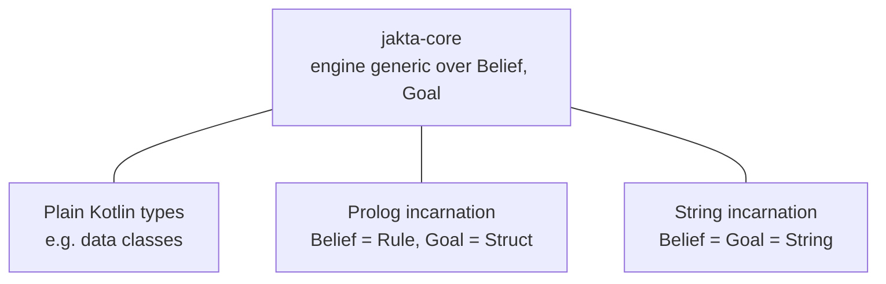

# Incarnations

The [BDI](../basic-concepts/bdi.mdx) model says *that* an agent has beliefs and goals, and plans that react to them;
it does not say *what* a belief or a goal is. Agent programming languages usually fix it once and for all:
AgentSpeak(L) and Jason represent both as logic terms, match plans by unification, and reason with logic programming.

JaKtA makes the knowledge representation a parameter instead. The engine is generic over the `Belief` and `Goal`
types, and never looks inside them: plans decide whether an event is relevant to them with their trigger, and whether
they apply with their guard, both ordinary Kotlin functions. So the representation is not part of the engine, and
can be chosen to fit the problem, in the spirit of blending agent-oriented programming with the paradigms Kotlin
already offers: logic terms where agents reason over what they know, plain objects where the domain is naturally
made of them.

An **incarnation** is such a choice: the belief and goal types, together with the helpers that make them pleasant to
use, such as builders for beliefs and goals, matchers for triggers, queries for guards, or a messaging protocol.
It is picked at compile time, by adding its dependency and using its types: there is no runtime switch, and the
compiler checks that plans and beliefs agree.

## Available incarnations

| Incarnation | Purpose | Matching | Reasoning | Messaging | Platforms |
|---|---|---|---|---|---|
| [Plain Kotlin types](../../how-to/custom-incarnation.md) | Domain-specific models | Any Kotlin function | Whatever you write | Raw `sendTo` | JVM, JS, native |
| [Prolog](./prolog/index.md) | Jason-style, logic-based agents | Unification, with variables bound into the plan | Inference rules, Prolog queries in guards | KQML (`tell`, `achieve`, `askOne`, ...) | JVM, JS |
| [String](pathname:///api/jakta-string-incarnation/index.html) | Demos and tests | Exact string equality or regex | Checks whether a belief is present | Raw `sendTo` | JVM, JS, native |

Plain Kotlin types need no incarnation at all: the [tutorials](../../tutorials/index.mdx) use strings and data classes,
and [Write your own incarnation](../../how-to/custom-incarnation.md) shows how to package your own types and helpers.
The Prolog incarnation has [its own section](./prolog/index.md), and the string incarnation an
[API reference](pathname:///api/jakta-string-incarnation/index.html).

Why the Alchemist incarnation is a different kind of incarnation

In the [Alchemist](https://alchemistsimulator.github.io/) simulator, an
[*incarnation*](https://alchemistsimulator.github.io/explanation/metamodel/index.html#incarnations) is a plug-in that
defines what runs on each simulated device. `alchemist-jakta-incarnation` is one of those: it runs JaKtA nodes on Alchemist's
devices, in simulated time, over Alchemist's network model.

It does not fix the belief and goal types, so it is not an incarnation in JaKtA's sense: it changes *where* agents run,
not how they represent their knowledge, and combines with any of the options above.
See [Simulate a MAS with Alchemist](../../how-to/alchemist.md).

