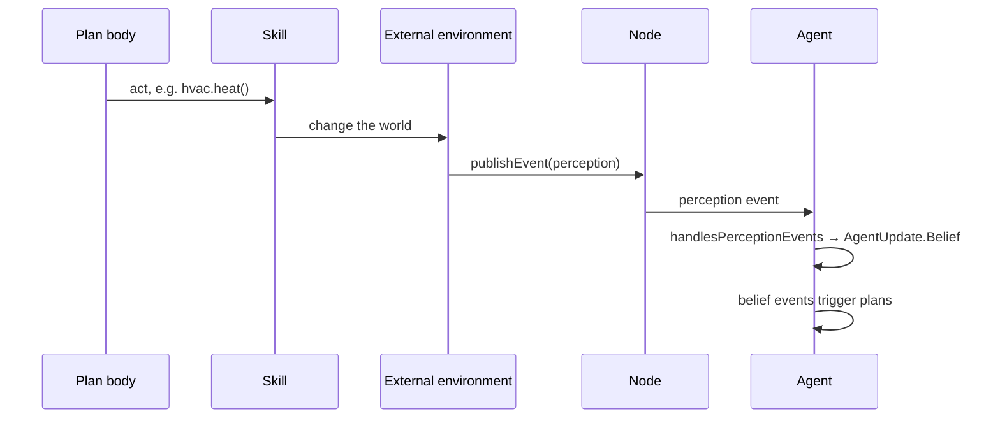

# Perception

An agent is situated in an environment: it perceives it through sensors and acts on it through actuators[^aima].
Perception is how the environment enters the agent's mind, updating what the agent believes about the world.
It can be **passive**, when the environment notifies the agent of what changed, or **active**, when the agent decides
to sense something as part of what it is doing, such as looking around before moving. Responding in time to changes
in the environment is what makes an agent **reactive**: together with being proactive, i.e. pursuing its own goals,
and social, i.e. interacting with other agents, it is one of the properties that characterise intelligent
agents[^wooldridge-jennings].

## Perceptions as events

JaKtA puts passive perception at the centre. Whatever models the environment publishes **perceptions** on the
[node](../nodes.md), as events, and each agent turns them into its own [beliefs](../basic-concepts/beliefs.md).
New beliefs generate events in turn, and the plans they trigger are the agent's reactions: an agent reacts to its
environment without polling it.



A perception is any class implementing `AgentEvent.External.Perception`. In the
[thermostat tutorial](../../tutorials/thermostat.md), the room publishes what the thermostat's display shows after
every step of time:

```kotlin
data class RoomReading(val temperature: Double, val target: Double, val mode: Mode) : Perception

node.publishEvent(RoomReading(state.temperature, state.target, state.mode))
```

:::info
Perceptions only reach the agents of the node that publishes them, possibly only those whose
[body](./embodiment.md) passes a filter; use [messages](./communication.md) to reach other nodes.
:::

## Each agent interprets what it perceives

A perception is not a belief. Each agent maps perceptions to belief updates with `handlesPerceptionEvents`, so that
the environment does not need to know how agents represent their knowledge: agents with different belief types, or
different [incarnations](../incarnations/index.md), can share the same environment, and each keeps only what matters
to it. The thermostat keeps a single belief about the room, and replaces it only when the reading changed:

```kotlin
handlesPerceptionEvents { perception ->
    when (perception) {
        is RoomReading -> {
            val belief = RoomBelief(perception.temperature.roundedToTenths(), perception.target, perception.mode)
            if (belief in beliefs) null else AgentUpdate.Belief(setOf(belief), beliefs.toSet())
        }
        else -> null
    }
}
```

Ignoring what did not change keeps belief events, and the plans they trigger, for actual news.

## Active perception

Agents are not limited to waiting for perceptions. A plan body is ordinary Kotlin code, so it can sense on purpose,
calling a [skill](./acting.md) that reads the environment: the reading is then a value in the plan, which the agent
can act on right away, or believe. The robots of the [Vacuum World showcase](../../showcase/vacuum-world.md) mix the
two: each action ends by publishing what the robot sees, and waits until the agent received it, so the plan goes on
with up-to-date beliefs.

:::info
The how-to [Connect agents to an external environment](../../how-to/connect-environment.md) puts publishing,
perceiving and acting together; with the Prolog incarnation, see
[Turn perceptions into Prolog facts](../../how-to/prolog/perceptions.md).
:::

[^aima]: Stuart Russell, Peter Norvig. *Artificial Intelligence: A Modern Approach*. Pearson, 4th edition, 2020.
[^wooldridge-jennings]: Michael Wooldridge, Nicholas R. Jennings. [Intelligent agents: theory and practice](https://doi.org/10.1017/S0269888900008122). The Knowledge Engineering Review 10(2), 1995.
