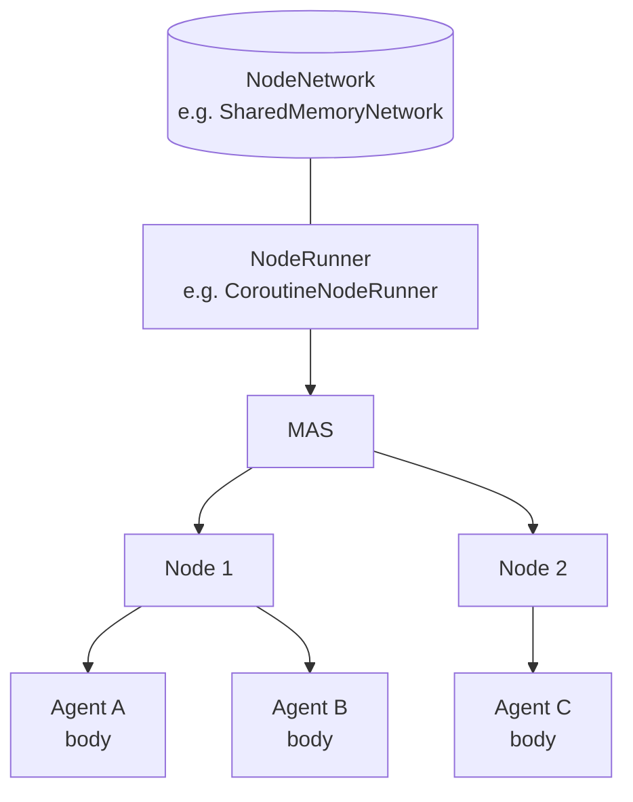

# Nodes

Multi-agent systems are often **distributed**: their agents live on different devices, such as robots, servers or
phones, that run and fail independently and can only talk over a network. JaKtA makes this structure explicit with
**nodes**. A node is a part of the MAS that lives on its own: it hosts a set of agents, connects them to the external
environment, and runs and stops independently of the other nodes. Agents on different nodes interact only through
[messages](./interaction/communication.md), as they would across a network, even when all the nodes run in the same
process. Where the nodes actually run, and how messages travel between them, is left to a **runner** and a
**network**, so the same MAS can run in a single process, in a simulation, or across real devices.

```kotlin
mas(NodeBuilders.baseNode()) {
    node {
        withAgents(helloWorldAgent)   // agents defined elsewhere with agent { }
        agent(BaseAgentID("inline")) { /* ... */ }
    }
    node { /* another node */ }
}.run(CoroutineNodeRunner(SharedMemoryNetwork()))
```



Nodes can also be defined on their own with `node(NodeBuilders.baseNode()) { ... }` and combined with
`mas(...) { withNodes(nodeA, nodeB) }`.

## What a node gives its agents

- a **body** for each agent, its representation inside the node: see [Embodiment](./interaction/embodiment.md);
- the **perceptions** published on the node: see [Perception](./interaction/perception.md);
- the **messages** sent to them, from any node: see [Communication](./interaction/communication.md);
- the **skills** wrapped around them with `context(...)`: see [Acting and skills](./interaction/acting.md).

From a plan body or a skill, the node also manages its agents (see
[Add and remove agents at runtime](../how-to/runtime-agents.md)): `node.addAgent(agentFactory)` adds a new agent,
`node.removeAgent(id)` removes one, and `node.terminateNode()` stops the node and all its agents.

## How nodes run

A MAS (`BaseMasBuilder.kt`) runs each of its nodes concurrently with the given `NodeRunner`, and `run` returns when
all nodes have terminated. `CoroutineNodeRunner(SharedMemoryNetwork())` runs every agent on coroutines, with all the
nodes in the same process; `runLocally()` is a shorthand for it. The
[Alchemist incarnation](../how-to/alchemist.md) runs nodes as simulated devices instead, with simulated time.

<details>
<summary>Runners, networks and system events</summary>

`CoroutineNodeRunner` (`CoroutineNodeRunner.kt`) runs a node as follows:

- it subscribes the node to a `NodeNetwork` and forwards the node's **system events** to it:
  agent additions and removals, messages, shutdown requests;
- it receives system events from the network, lets the node handle them, and reacts to them:
  it starts a coroutine for every added agent, running its [reasoning cycle](./execution-model.md), cancels removed
  agents, and stops the node on shutdown.

`SharedMemoryNetwork` (`SharedMemoryNetwork.kt`) is an in-process network that broadcasts every system event to
every subscribed node.

</details>

### How events reach agents

The two kinds of external events reach agents differently (`BaseNode.kt`):

- **Perceptions** published with `node.publishEvent(...)` are delivered directly to the node's own agents whose body
  passes the filter. They never leave the node.
- **Messages** travel as system events through the network, so every node receives them and delivers them to its
  local agents that pass the filter. This is how `sendTo` reaches agents on other nodes.

`MessagingSkill.sendTo` addresses the receiver through its body: the filter selects the agent whose body
maps back to the receiver's ID (`Node.getAgentIDfromBody`), which is why each agent needs a
[distinct body](./interaction/embodiment.md#what-a-body-is-for).

### Adding, removing and terminating

- `node.addAgent(factory)` and the agents declared in `node { }` are posted as agent-addition system events.
  Each agent starts once its node's runner receives the event, so the change shows up in `node.agents` shortly after.
- `node.removeAgent(id)` posts a removal event: the runner cancels the agent's reasoning loop. Since intentions only
  progress through the Step events handled by that loop, none of them runs any further.
- An agent whose loop crashes with an unexpected exception is removed from its node.
- `node.terminateNode()` posts a shutdown event for the node. When the runner receives it, it closes the node's
  subscription and cancels all the node's agents; the node's `run` then completes.
