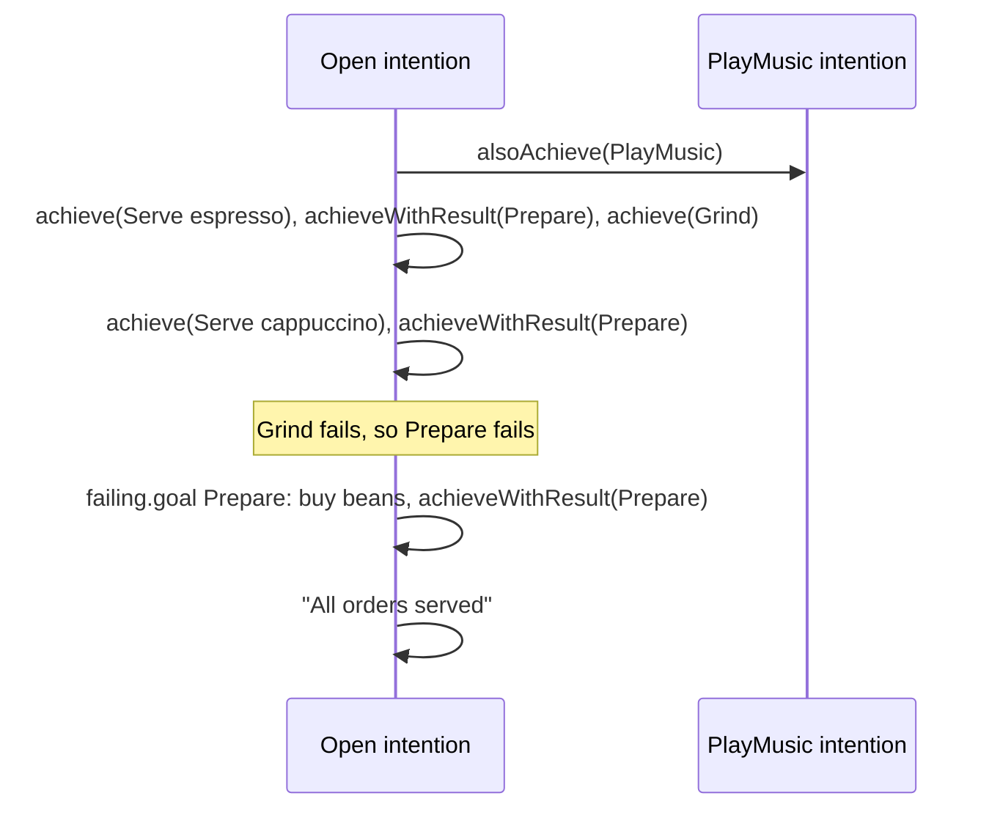

# Achieve sub-goals and recover from failures

A plan can pursue other goals: wait for a **sub-goal** within its own intention, get the result of the plan that
achieved it, or start a **concurrent intention** and carry on; and when a sub-goal fails, a **failure plan** can
recover from it. This guide follows a barista serving two orders.

:::info[Complete example]
The [`sub-goals`](https://github.com/jakta-bdi/jakta/tree/main/examples/sub-goals) example; run it with
`./gradlew :examples:sub-goals:run`.
:::

The goals are plain Kotlin types, and each trigger accepts the goals of its type, which become the plan's context:

```kotlin
sealed interface Task
data object Open : Task
data object PlayMusic : Task
data class Serve(val coffee: String) : Task
data class Prepare(val coffee: String) : Task
data object Grind : Task
```

## Achieve a sub-goal

`agent.achieve(goal)` (from `it.unibo.jakta.agent.achieve`) pursues the goal in the **current** intention,
and returns when it is achieved: the orders are served one after the other.

```kotlin
adding.goal { this as? Open } triggers {
    agent.achieve(Serve("espresso"))
    agent.achieve(Serve("cappuccino"))
    agent.print("All orders served")
}
```

## Get the result of a sub-goal

A plan body is a Kotlin function, and its last expression is the plan's result.
`agent.achieveWithResult(goal)` (from `it.unibo.jakta.agent.achieveWithResult`) pursues the goal like `achieve`,
and returns that result:

```kotlin
adding.goal { this as? Prepare } triggers {
    agent.achieve(Grind)
    agent.print("Brewing the ${context.coffee}")
    "cup of ${context.coffee}"
}
adding.goal { this as? Serve } triggers {
    val cup: String = agent.achieveWithResult(Prepare(context.coffee))
    agent.print("Here is your $cup!")
}
```

The result type comes from the declared type of the variable, here `String`.

## Start a concurrent intention

`agent.alsoAchieve(goal)` starts a **new** intention for the goal and returns immediately, without waiting for it:
the music plays while the barista works.

```kotlin
adding.goal { this as? Open } triggers {
    agent.alsoAchieve(PlayMusic)
    agent.achieve(Serve("espresso"))
    // ...
}
```

:::info
Every initial goal, and every plan triggered by an event, also runs in its own intention.
:::

## Recover from a failed sub-goal

A goal fails when no plan for it is applicable, or when its plan throws. The failure goes up the chain of
sub-goals, until a `failing.goal { }` plan handles it. Grinding needs beans, and there are only enough for one coffee:

```kotlin
adding.goal { this as? Grind } onlyWhen { context.takeIf { "beans" in beliefs } } triggers {
    agent.print("Grinding the beans")
    agent.forget("beans")
}
```

The second `Grind` has no applicable plan, so it fails, and so does the `Prepare` that was waiting for it.
A failure plan for `Prepare` buys beans and prepares the coffee again:

```kotlin
failing.goal { this as? Prepare } triggers {
    agent.print("I could not prepare the ${context.coffee}: buying beans and trying again")
    agent.believe("beans")
    val cup: String = agent.achieveWithResult(context)
    cup
}
```

The result of the failure plan completes the failed goal: the `Serve` waiting for the cappuccino gets its cup and
carries on as if nothing happened. Without a failure plan, the failure would reach `Serve` and then `Open` in turn.



See [the execution model](../explanation/execution-model.md#achieve-vs-alsoachieve) for how intentions and failures
work underneath.
