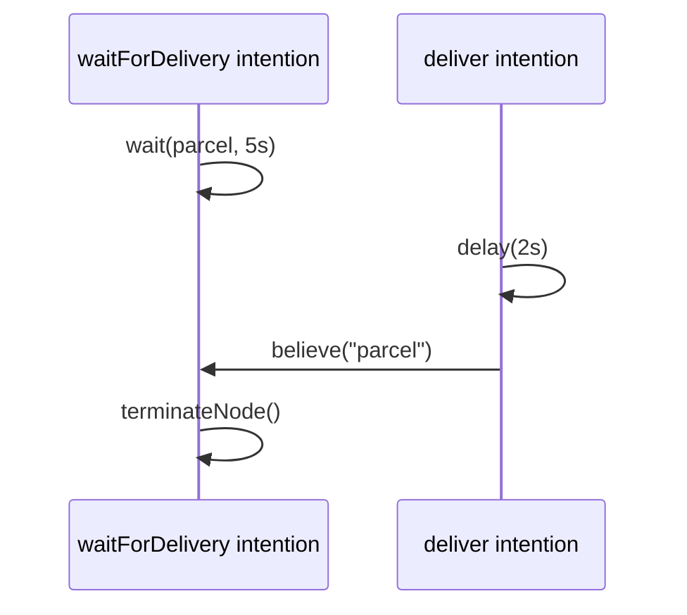

# Wait for events and use time

Plan bodies are `suspend` functions running on coroutines, so an intention can pause, for some time or until
something happens, without blocking the agent: its other intentions keep running meanwhile.

:::info[Complete example]
The [`wait-for-events`](https://github.com/jakta-bdi/jakta/tree/main/examples/wait-for-events) example; run it with
`./gradlew :examples:wait-for-events:run`.
:::

## Wait for some time

Use `delay` from `kotlinx.coroutines`:

```kotlin
} triggers {
    delay(1.seconds)
}
```

:::tip
In [Alchemist simulations](./alchemist.md), `delay` advances in **simulated** time.
:::

## Wait for an event

`agent.wait(filter, timeout)` suspends the intention until the agent receives an event for which `filter` returns
a non-null value, and returns that value; after `timeout`, it returns `null`.
The filter is called on each event the agent handles while the intention waits: returning `null` means
"not this one", and the intention keeps waiting for the next event.
The filter sees every event the agent handles: belief and goal events (`AgentEvent.Internal`), as well as incoming
messages and perceptions (`AgentEvent.External`).

```kotlin
private fun beliefAdded(expected: String): (AgentEvent) -> String? = { event ->
    ((event as? AgentEvent.Internal.Belief.Add<*>)?.belief as? String)?.takeIf { it == expected }
}
```

```kotlin
} triggers {
    val parcel = agent.wait(beliefAdded("parcel"), timeout = 5.seconds)
    if (parcel != null) agent.print("Parcel received!") else agent.print("Gave up waiting")
}
```

## Put it together

The two initial goals of the example run in two intentions: one waits for the parcel while the other delivers it.



To start intentions from a plan, or to wait for a sub-goal, see [Achieve sub-goals and recover from failures](./sub-goals.md).
