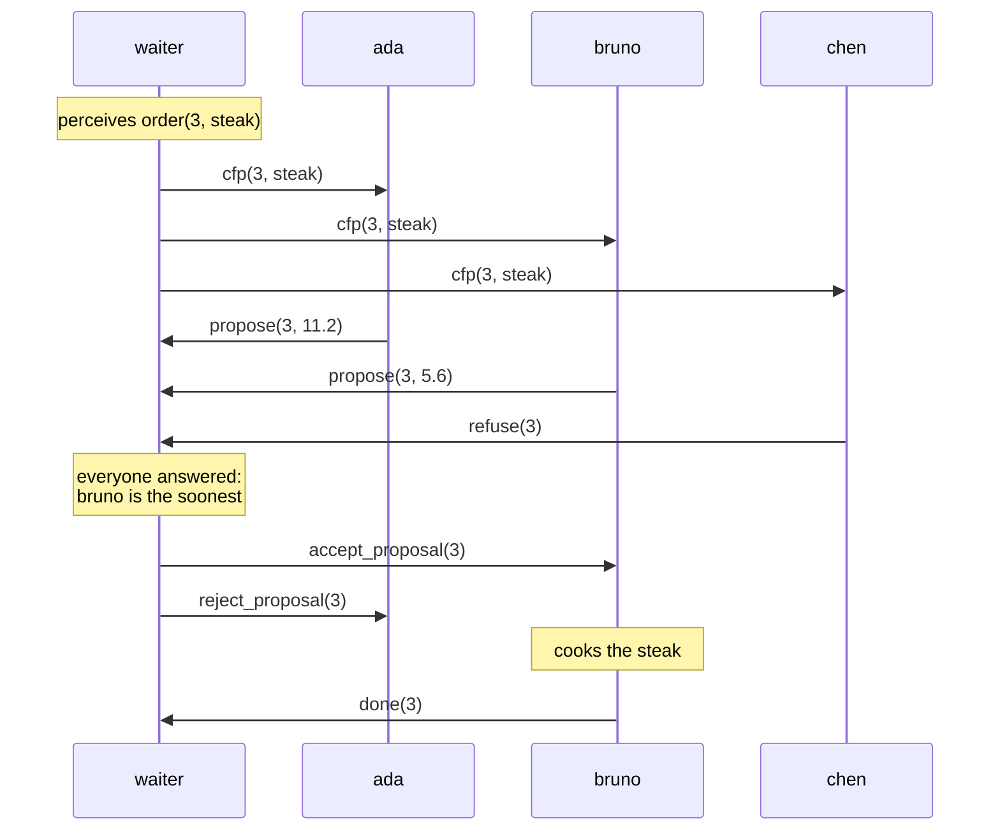
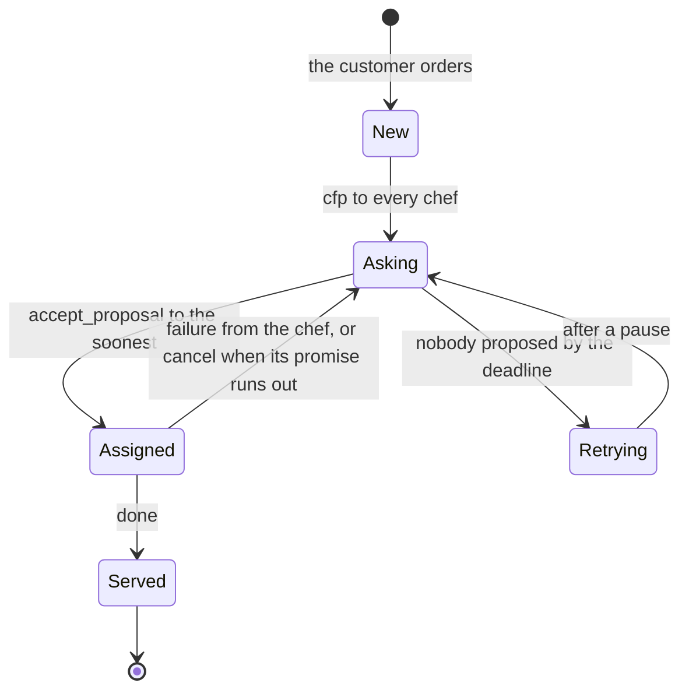

# Contract Net: a busy kitchen

import ExampleApp from '@site/src/components/ExampleApp/ExampleApp';

The contract net is a classic protocol for sharing work among agents: a manager announces a task, the agents able to
do it make an offer, and the manager gives the task to the best one. The
[contract-net example](https://github.com/jakta-bdi/jakta/tree/main/examples/contract-net) runs it in a restaurant.

Customers order dishes. A waiter takes each order and asks one to four chefs, each in their own kitchen, who can
have it ready the soonest. Every dish is cooked at one station (salad at the chopping board, steak and burger on the
grill, soup on the stove, pizza and cake in the oven), and no kitchen has them all. Chefs walk between their stations
and the pass, where dishes are served. Each agent runs on its own node, as if on its own machine: the restaurant is a
small distributed system, where agents meet only through messages.

It runs below, right in your browser.

:::tip[How to use it]
- Choose how many **Chefs** to hire, from one to four, and press **Open the restaurant**; **Reset** closes it.
- Press a dish under **Order a dish** to order it, as many times as you like.
- Click a station in a kitchen to switch it off or on, also while the chef works.
- Press **Nap** on a chef's card to send the chef to sleep: asleep, it is offline, and misses every message.
  **Wake up** brings it back online.
- **Speed** sets how fast the restaurant's clock goes.
- The *messages* panel shows what the agents tell each other, and the *agent trace* what they print while they
  reason.
:::

<ExampleApp name="contract-net" title="Contract Net" />

```bash
./gradlew :examples:contract-net:run                     # desktop
./gradlew :examples:contract-net:jsBrowserDevelopmentRun # browser
```

## Why it matters

The other showcases are about one agent reasoning on its world. Here the interesting part happens **between** agents:
no one tells the chefs what to cook, and the waiter knows nothing of their kitchens. They agree on who cooks what by
following a **protocol**, a conversation of [KQML](../explanation/incarnations/prolog/kqml.md) messages, and what one
agent tells another becomes a **belief annotated with its source**, so the waiter knows who said what. By bidding the
time they need, the chefs **balance the load** among themselves, without anyone planning it. And the protocol copes
**when things go wrong**: the waiter does not wait forever for a chef that does not answer, a chef that can no longer
keep a promise gives the order back, and the waiter takes it back from one that went offline.

### The protocol

Each order goes through one round of the contract net:



- The waiter calls for proposals, `cfp(Id, D)`, with a broadcast to every other agent.
- A chef whose kitchen has the station of the dish proposes `propose(Id, T)`, where `T` is how many seconds until it
  would be ready; a chef without it refuses with `refuse(Id)`.
- The waiter accepts the soonest proposal with `accept_proposal(Id)`, and rejects the others with
  `reject_proposal(Id)`.
- The chef that won the order cooks it, serves it at the pass, and tells `done(Id)`.

Every message is a `tell`: it adds a belief to the receiver, and the receiver's plans react to it. So the protocol is
written as plans, one for each message an agent can receive. This is a chef's, for a call for proposals it can
cook:

```kotlin
prologPlan {
    adding.belief { matchingBelief { "cfp"(I, D)[source(W)] } } onlyWhen {
        satisfies { "needs"(D, S) and "station"(S) }
    } triggers {
        val order: Int = I.value()
        val dish = dishNamed(D.value())
        val readyIn = agent.beliefs.readyIn(dish)
        agent.forgetAll("cfp", order)
        agent.believe(belief { "proposal"(I, D) })
        agent.print("I can have the ${dish.name.lowercase()} of order $order ready in $readyIn")
        agent.tellTo(waiter, proposeBelief(order, readyIn))
    }
}
```

`needs(D, S)` is an initial belief of every chef, one for each dish of the menu; `station(S)` is what the chef
perceives of its kitchen. The plan after this one has only `needs(D, S)` as guard: it applies when the kitchen lacks
the station, and refuses. The chef also remembers its `proposal(Id, D)`, to know which dish it promised when the
answer comes, and forgets the call: it handled it.

Before any order, each chef introduces itself to the waiter with `introduction(participant, N)`, telling its name. That
is how the waiter knows how many chefs to wait for, and how to call them.

### Beliefs with a source

What an agent is told is annotated with who told it: a chef's proposal is the waiter's belief
`propose(3, 5.6)[source(S)]`, where `S` is the chef's ID. The waiter's decisions are Prolog rules over these beliefs:
`next_order` is the oldest order waiting, and `best` the soonest proposal for an order:

```kotlin
believes {
    // next_order(I, D): the order I, of the dish D, is the oldest one waiting
    +inferenceRule {
        "next_order"(I, D) impliedBy ("order"(I, D) and not("order"(J, `_`) and Struct.of("<", J, I)))
    }
    // best(I, T): T is the soonest a chef proposed to have the order I ready
    +inferenceRule {
        "best"(I, T) impliedBy ("propose"(I, T) and not("propose"(I, U) and Struct.of("<", U, T)))
    }
}
```

Once the answers are in, the waiter awards the order with the plan whose guard finds the `best` proposal:

```kotlin
prologPlan {
    adding.goal { matchingGoal { "award"(I, D) } } onlyWhen { satisfies { "best"(I, T) } } triggers {
        val winner = agent.beliefs.proposerOf(I.value(), T.value())
        val chef = agent.beliefs.chefFrom(winner)
        val source = Atom.of(winner)
        agent.print("Order ", I, " goes to ${chef.displayName}, ready in ", T, " s")
        agent.believe(belief { "assigned"(I, D, source) })
        agent.tellTo(chef, belief { "accept_proposal"(I) })
        agent.alsoAchieve(goal { "watch"(I, D, source, T) })
        agent.beliefs.proposersOf(I.value()).filter { it != winner }
            .forEach { agent.tellTo(agent.beliefs.chefFrom(it), belief { "reject_proposal"(I) }) }
        agent.track(I.value(), OrderStatus.Assigned(chef.displayName, T.value<Double>().seconds))
    }
}
```

Guards and rules see what a belief says, not who said it, so `proposerOf` reads the source of the winning proposal
([`Beliefs.kt`](https://github.com/jakta-bdi/jakta/blob/main/examples/contract-net/src/commonMain/kotlin/Beliefs.kt)),
and `chefFrom` turns it back into the chef's ID, with the name the chef gave in its `introduction`. In a trigger,
instead, `[source(S)]` binds the sender like any other variable: the waiter's plans for `done` and `failure` use it to
tell which chef answered. A second plan for `award`, with no guard, handles an order nobody proposed for.

### Load balancing emerges

A chef's bid is the time it needs for everything it already took, and then this dish: for each dish, walking to the
station, cooking it, and walking back to the pass:

```kotlin
internal fun Collection<PrologBelief>.readyIn(dish: Dish): Duration {
    val dishes = tickets().map { it.dish } + dish
    val work = dishes.fold(Duration.ZERO) { time, next -> time + WALK_TIME * 2 + next.cookingTime }
    return (work.inWholeMilliseconds / TENTH_MILLIS * TENTH_MILLIS).milliseconds
}
```

Order three steaks in a row, with Ada, Bruno and Dara in the kitchens: they all have a grill. All three are free and
bid the same for the first, which goes to the first to answer; that chef would now need twice as long, so the second
goes to one of the others, and the third to the last one. The orders spread over the kitchens with a grill, yet no
rule says to spread them: each chef only says how busy it is, and the waiter only picks the soonest. Bids count time,
not orders: a chef with one cake to bake is busier than one with two burgers to grill.

For this to work, a chef must bid knowing the orders it already won. So the waiter runs **one auction at a time**,
the oldest order first, in an endless loop: the answer to an auction reaches each chef before the next call for
proposals does.

### When things go wrong

Each control of the app, besides ordering, breaks the happy path in a different way, and the protocol has an answer
for each:

| You | The protocol |
|---|---|
| send a chef to nap | it is offline: the waiter decides at a **deadline**, without it |
| switch off a station a chef needs | the chef **gives the order back** with `failure(Id)` |
| leave a chef with orders asleep | the waiter **takes them back** with `cancel(Id)`, when its promises run out |
| wake a chef up | it introduces itself again, and **gives back** all its orders |
| order a dish no kitchen can cook now | the waiter asks again after a pause |

#### A deadline instead of waiting forever

A napping chef is offline: whatever is sent to it is lost, and the *messages* panel shows it struck through. The chef's
message handler drops it before it becomes a belief:

```kotlin
handlesMessageEvents { message ->
    (message.payload as? KQMLPayload)?.let { payload ->
        val (performative, content) = payload.describe()
        // napping, the chef is offline: the message never reaches it
        val offline = kitchen.state.value.napping
        restaurant.log(message.sender.displayName, kitchen.chef, performative, content, lost = offline)
        if (offline) null else handleKQMLPayload(payload, message.sender)
    }
}
```

The waiter cannot tell an offline chef from a slow one, so it waits for the answers until a **deadline**, 1.5 seconds
on the restaurant's clock, and then decides with the ones it has:

```kotlin
private suspend fun RestaurantAgent.awaitAnswers(id: Int) {
    fun everyoneAnswered() = beliefs.answersTo(id).size >= beliefs.participants()
    if (everyoneAnswered()) return
    val deadline = with(board) { realTime(DEADLINE) }
    wait({ event -> event.takeIf { it is AgentEvent.Internal.Belief.Add<*> && everyoneAnswered() } }, deadline)
}
```

`agent.wait` suspends the plan until an event satisfies the filter, here a belief that completes the answers, or until
the timeout. Meanwhile the waiter keeps handling the messages that arrive, which is how those beliefs get there. If
nobody proposes, because nobody is online or has the station, the order is ordered again after a pause, until someone
can cook it.

#### Giving an order back

Switch off a station while a chef has orders for it: the chef can no longer keep its promise. A rule tells which
orders are lost:

```kotlin
// lost(I, D): the chef took the order I, but its kitchen no longer has the station of the dish D
+inferenceRule { "lost"(I, D) impliedBy ("ticket"(I, D) and "needs"(D, S) and not("station"(S))) }
```

Before cooking its next order, the chef gives the lost ones back, telling `failure(Id)`. Turning the station off in
the middle of cooking stops the cooking too, and the chef gives that order back the same way. The waiter remembered
the order as `assigned(Id, D, S)`, with the chef it gave it to: on a `failure` from that chef it believes
`order(Id, D)` again, and the order goes back into its loop, for a new round.

#### Taking an order back

A chef that falls asleep with orders on its rail cannot give them back. The waiter notices: the bid was a promise,
and when it accepts one, it starts a concurrent intention that watches it, with some grace, half as long again as
promised:

```kotlin
prologPlan {
    adding.goal { matchingGoal { "watch"(I, D, S, T) } } triggers {
        val deadline = agent.realTime(T.value<Double>().seconds * GRACE)
        val answer = agent.wait({ event -> event.takeIf { it.isOutcomeOf(I.value()) } }, deadline)
        if (answer == null && belief { "assigned"(I, D, S) } in agent.beliefs) {
            val chef = agent.beliefs.chefFrom(S.value())
            agent.forget(belief { "assigned"(I, D, S) })
            agent.print("${chef.displayName} is late with order ", I, ": I take it back")
            agent.tellTo(chef, belief { "cancel"(I) })
            agent.believe(belief { "order"(I, D) })
        }
    }
}
```

If neither `done` nor `failure` arrives in time, the waiter calls the order off with `cancel(Id)`, and the order goes
back into its loop, like a failed one. A chef that is awake but late drops the cancelled order; an offline one never
hears of it. For this to be fair, the bid must be honest: it counts the walking too, so an awake chef keeps its
promises, and the grace covers the rest.

#### Back online

A chef waking up cannot know what happened while it was offline: maybe the waiter took its orders back, maybe not.
So it starts over: it introduces itself again, harmless if the waiter still knows it, and gives back every order it
holds:

```kotlin
prologPlan {
    removing.belief { matchingBelief { napping } } triggers {
        agent.print("I'm back! I give back my orders: the waiter may have taken them back")
        agent.introduce(kitchen.chef, waiter)
        agent.beliefs.tickets().forEach { agent.giveBack(it, waiter) }
    }
}
```

The waiter orders again those it still had assigned to that chef, and ignores the others: `assigned(Id, D, S)` names
the chef, so a `failure`, or a late `done`, only counts from the chef that still has the order.

### An order's life

Every path an order can take, from the customer to the pass:


