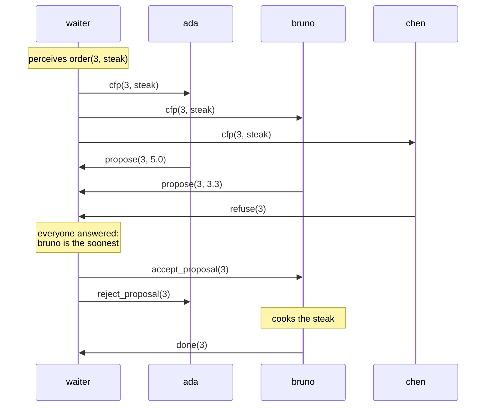

# Contract Net: a busy kitchen

import ExampleApp from '@site/src/components/ExampleApp/ExampleApp';

The contract net is a classic protocol for sharing work among agents: a manager announces a task, the agents able to
do it make an offer, and the manager gives the task to the best one. The
[contract-net example](https://github.com/jakta-bdi/jakta/tree/main/examples/contract-net) runs it in a restaurant,
following the contract net of [Jason](https://jason-lang.github.io/).

Customers order dishes. A waiter takes each order and asks one to four chefs, each in their own kitchen, who can
have it ready the soonest. Every dish is cooked at one station (salad at the chopping board, steak on the grill, soup
on the stove, pizza in the oven), and no kitchen has them all. Chefs work at different speeds, and walk between their
stations and the pass, where dishes are served.

Choose how many chefs to hire, open the restaurant, and order some dishes. You can switch a kitchen's stations on and
off by clicking them, and send a chef to nap, also while they work. The *messages* panel shows what the agents tell
each other, and the *agent trace* what they print while they reason.

<ExampleApp name="contract-net" title="Contract Net" />

```bash
./gradlew :examples:contract-net:run                     # desktop
./gradlew :examples:contract-net:jsBrowserDevelopmentRun # browser
```

## Why it matters

The other showcases are about one agent reasoning on its world. Here the interesting part happens **between** agents:
no one tells the chefs what to cook, and the waiter knows nothing of their kitchens. They agree on who cooks what by
following a **protocol**, a conversation of [KQML](../explanation/incarnations/prolog/kqml.md) messages, and each
agent runs on **its own node**, as if each worked on its own machine. The waiter decides with what it was told, and
**does not wait forever**: a chef that does not answer is simply left out. What the others tell becomes **beliefs
annotated with their source**, so the waiter knows who said what. And by bidding the time they need, the chefs
**balance the load** among themselves, without anyone planning it. When a chef can no longer keep a promise, the
protocol has a way to **give the order back**, and when a chef breaks one without a word, the waiter **takes it back**.

### The protocol

Each order goes through one round of the contract net:



- The waiter calls for proposals, `cfp(Id, D)`, with a broadcast to every other agent.
- A chef whose kitchen has the station of the dish proposes `propose(Id, T)`, where `T` is how many seconds until it
  would be ready; a chef without it refuses with `refuse(Id)`.
- The waiter accepts the soonest proposal with `accept_proposal(Id)`, and rejects the others with
  `reject_proposal(Id)`.
- The chef that won the order cooks it, serves it at the pass, and tells `done(Id)`.
- If `done(Id)` does not come in the time the chef promised, the waiter takes the order back with `cancel(Id)`.

Every message is a `tell`: it adds a belief to the receiver, and the receiver's plans react to it. So the protocol is
written as plans, one for each message an agent can receive. This is a chef's, for a call for proposals it can
cook:

```kotlin
prologPlan {
    adding.belief { matchingBelief { "cfp"(I, D)[source(W)] } } onlyWhen {
        satisfies { "needs"(D, S) and "station"(S) }
    } triggers {
        val order: Int = I.value()
        val dish = dishNamed(D.value())
        val readyIn = agent.beliefs.readyIn(dish)
        agent.forgetAll("cfp", order)
        agent.believe(belief { "proposal"(I, D) })
        agent.print("I can have the ${dish.name.lowercase()} of order $order ready in $readyIn")
        agent.tellTo(waiter, proposeBelief(order, readyIn))
    }
}
```

`needs(D, S)` is an initial belief of every chef, one for each dish of the menu; `station(S)` is what the chef
perceives of its kitchen. The plan after this one has only `needs(D, S)` as guard: it applies when the kitchen lacks
the station, and refuses. The chef also remembers its `proposal(Id, D)`, to know which dish it promised when the
answer comes, and forgets the call: it handled it.

Before any order, each chef introduces itself to the waiter with `introduction(participant, N)`, telling its name. That
is how the waiter knows how many chefs to wait for, and how to call them.

### Each agent on its own node

The waiter and each chef run on a node of their own
([`RunRestaurant.kt`](https://github.com/jakta-bdi/jakta/blob/main/examples/contract-net/src/commonMain/kotlin/RunRestaurant.kt)),
connected by a network:

```kotlin
val waiterId = BaseAgentID("waiter")
val dining = node(NodeBuilders.baseNode<Any>()) {
    context(MessagingSkill(node), WaiterSkill(node)) { withAgents(waiter(waiterId, restaurant)) }
}
val kitchenNodes = kitchens.map { kitchen ->
    node(NodeBuilders.baseNode<Any>()) {
        context(MessagingSkill(node), KitchenSkill(node)) {
            withAgents(chef(BaseAgentID(kitchen.chef), kitchen, waiterId, restaurant))
        }
    }
}
mas(NodeBuilders.baseNode()) { withNodes(dining, *kitchenNodes.toTypedArray()) }
    .run(CoroutineNodeRunner(SharedMemoryNetwork()))
```

Messages reach agents on every node, perceptions only those of the node that publishes them: the waiter perceives
the orders, and each chef only its own kitchen. The chefs know the waiter's ID from the start, to introduce themselves;
the waiter learns about the chefs only from their messages. Nothing else is shared: the code of the agents would be
the same on as many machines.

### A deadline instead of waiting forever

A napping chef does not hear the calls for proposals: its first plan for a `cfp` applies while it believes
`napping`, and only forgets the call. The waiter cannot tell a sleeping chef from a slow one, so it waits for the
answers until a **deadline**, 1.5 seconds on the restaurant's clock, and then decides with the ones it has:

```kotlin
private suspend fun RestaurantAgent.awaitAnswers(id: Int) {
    fun everyoneAnswered() = beliefs.answersTo(id).size >= beliefs.participants()
    if (everyoneAnswered()) return
    val deadline = with(board) { realTime(DEADLINE) }
    wait({ event -> event.takeIf { it is AgentEvent.Internal.Belief.Add<*> && everyoneAnswered() } }, deadline)
}
```

`agent.wait` suspends the plan until an event satisfies the filter, here a belief that completes the answers, or until
the timeout. Meanwhile the waiter keeps handling the messages that arrive, which is how those beliefs get there.
Jason's contract net does the same with `.wait(all_proposals_received(Id), 4000, _)`.

Send a chef to nap and order a dish: the order stays on *asking the chefs...* for the deadline, and goes to someone
else. If nobody proposes, because nobody is awake or has the station, the order is ordered again after a pause, until
someone can cook it.

### Beliefs with a source

What an agent is told is annotated with who told it: a chef's proposal is the waiter's belief
`propose(3, 3.3)[source(S)]`, where `S` is the chef's ID. The waiter collects the bids from these beliefs in plain
Kotlin
([`Beliefs.kt`](https://github.com/jakta-bdi/jakta/blob/main/examples/contract-net/src/commonMain/kotlin/Beliefs.kt)),
and picks the soonest:

```kotlin
val bids = beliefs.bidsFor(order.id)
beliefs.answersTo(order.id).forEach(::forget)

val best = bids.minByOrNull { it.readyIn }
if (best == null) {
    print("Nobody can cook order ${order.id} now: I'll ask again soon")
    track(order.id, OrderStatus.Retrying)
    alsoAchieve(order.goal("order_again"))
} else {
    val chef = beliefs.chefFrom(best.source)
    print("Order ${order.id} goes to ${chef.displayName}, ready in ${best.readyIn}")
    believe(order.assignedTo(best.source))
    tellTo(chef, orderBelief("accept_proposal", order.id))
    alsoAchieve(order.watchGoal(best.readyIn))
    (bids - best).forEach { tellTo(beliefs.chefFrom(it.source), orderBelief("reject_proposal", order.id)) }
    track(order.id, OrderStatus.Assigned(chef.displayName, best.readyIn))
}
```

The source is also how the waiter answers: `chefFrom` turns it back into the chef's ID, with the name the chef gave in
its `introduction`. In plans, `[source(S)]` binds the sender like any other variable: the waiter's plans for `done`
and `failure` use it to tell which chef answered.

### Load balancing emerges

A chef's bid is the time it needs for everything it already took, and then this dish, at its speed: for each dish,
walking to the station, cooking it, and walking back to the pass:

```kotlin
internal fun Collection<PrologBelief>.readyIn(dish: Dish): Duration {
    val dishes = tickets("ticket").map { it.dish } + dish
    val work = dishes.fold(Duration.ZERO) { time, next -> time + WALK_TIME * 2 + next.cookingTime } / speed()
    return (work.inWholeMilliseconds / TENTH_MILLIS * TENTH_MILLIS).milliseconds
}
```

Order three steaks in a row. Dara is the fastest at the grill and wins the first; for the second, Dara would need
twice as long, and Bruno wins it; for the third, both have one steak to cook, and Ada, slow but idle, wins it. The
orders spread over the kitchens with a grill, yet no rule says to spread them: each chef only says how busy it is, and
the waiter only picks the soonest.

For this to work, a chef must bid knowing the orders it already won. So the waiter runs **one auction at a time**,
the oldest order first, in an endless loop like the chefs' (see below): the answer to an auction reaches each chef
before the next call for proposals does.

### Giving an order back

Switch off a station while a chef has orders for it: the chef can no longer keep its promise. Its plan for the
removal of a `station` belief gives those orders back, telling `failure(Id)`, the message the FIPA contract net uses
when a contractor fails after accepting:

```kotlin
prologPlan {
    removing.belief { matchingBelief { "station"(S) } } triggers {
        agent.beliefs.tickets("ticket").filter { it.dish.station.toAtom() == S.value<Atom>() }
            .forEach { agent.giveUp(it, waiter) }
    }
}
```

The waiter remembered the order as `assigned(Id, D, S)`, with the chef it gave it to: on a `failure` from that chef
it believes `order(Id, D)` again, and the order goes back into its loop, for a new round. Turning the station off in the middle of cooking stops the cooking too: the
kitchen notices the missing station, `cook` returns `false`, and the chef gives the order back the same way.

### Taking an order back

A chef that falls asleep with orders on its rail cannot give them back: it does not even know it is late. The waiter
does: the bid was a promise, and when it accepts one, it starts a concurrent intention that watches it, with some
grace, half as long again as promised:

```kotlin
prologPlan {
    adding.goal { matchingGoal { "watch"(I, D, T) } } triggers {
        val order = Ticket(I.value(), dishNamed(D.value()))
        val deadline = agent.realTime(T.value<Double>().seconds * GRACE)
        val answer = agent.wait({ event -> event.takeIf { it.isOutcomeOf(order.id) } }, deadline)
        val chef = agent.beliefs.assignee(order.id)?.let { agent.beliefs.chefFrom(it) }
        if (answer == null && chef != null) {
            agent.forgetAll("assigned", order.id)
            agent.print("${chef.displayName} is late with order ${order.id}: I take it back")
            agent.tellTo(chef, orderBelief("cancel", order.id))
            agent.believe(order.belief("order"))
        }
    }
}
```

If neither `done` nor `failure` arrives in time, the waiter tells the chef `cancel(Id)`, the message the initiator of
a FIPA contract net uses to call a contract off, and the order goes back into its loop, like a failed one. The
sleeping chef still hears it, as only its calls for proposals go unheard: it takes the ticket off its rail, and stops
cooking it if it was on the stove. Send a chef with a few orders to nap: one after the other, they find another
kitchen.

For this to be fair, the bid must be honest: it counts the walking too, so an awake chef keeps its promises, and the
grace covers the rest. A `done` that arrives too late is simply forgotten: `assigned(Id, D, S)` names the chef, so
the waiter only accepts it from the chef that still has the order.

### Two endless loops

Both agents work like the robots of the [Vacuum World](./vacuum-world.md#continuous-goal-driven-behaviour): one goal,
`work` for a chef and `wait_tables` for the waiter, pursued one step at a time, each step adopting the goal again. A
chef's steps, in order of priority:

| Condition | Step |
|---|---|
| `napping` | sleep until it no longer believes `napping` |
| the oldest ticket's station is there | walk to it, cook, walk to the pass, serve, tell `done(Id)` |
| a ticket without its station | give it back with `failure(Id)` |
| otherwise | wait for a new `ticket` |

The steps act through the chef's skill, `KitchenSkill`, on the kitchen, the chef's body: walking and cooking take time
on the restaurant's clock, and stop while the chef naps.

### Paradigm blending

The protocol is written in Prolog: the messages are Prolog facts, plans match them, and guards like
`"needs"(D, S) and "station"(S)` decide what a chef can do. Numbers and lists are left to Kotlin: adding up cooking
times, finding the soonest bid, choosing the oldest order. Plans and guards call these Kotlin functions directly, on
the agent's beliefs, and
[`Beliefs.kt`](https://github.com/jakta-bdi/jakta/blob/main/examples/contract-net/src/commonMain/kotlin/Beliefs.kt)
keeps the boundary between the two in one place: it is the only file where Kotlin code builds a Prolog term or takes
one apart.
