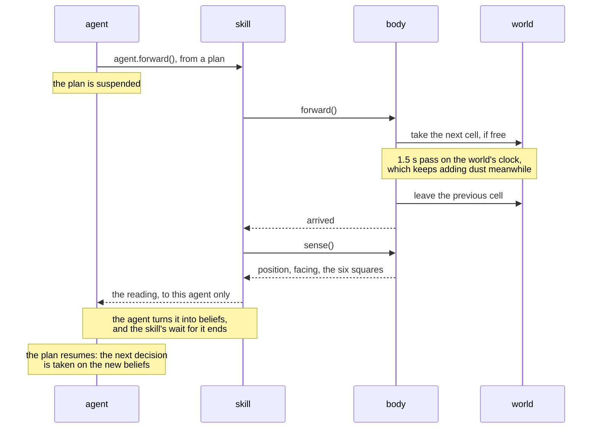

# Vacuum World

import ExampleApp from '@site/src/components/ExampleApp/ExampleApp';

The vacuum world is a classic testbed for agent programming: robots move around a grid, avoid the obstacles, and
find and clean the dust. The [vacuum-world example](https://github.com/jakta-bdi/jakta/tree/main/examples/vacuum-world)
is inspired by the [EIS Vacuum World](https://github.com/eishub/vacuumworld).

One to four robots keep the map clean forever. Each perceives only its position, where it faces,
and what the six squares it sees hold (here, left, forward-left, forward, forward-right and right), and acts by
turning, moving forward and cleaning. Actions take time, and the world runs on its own clock, getting new dust
every second.

Choose how many robots to use, press *Start* and watch them work. You can change the speed and how often dust
appears, and click a square to drop or remove some, also while the robots work.

It runs below, right in your browser: the *agent trace* on the right shows what the agents print while they reason.

<ExampleApp name="vacuum-world" title="Vacuum World" />

```bash
./gradlew :examples:vacuum-world:run                     # desktop
./gradlew :examples:vacuum-world:jsBrowserDevelopmentRun # browser
```

## Why it matters

Most examples run until their goal is achieved. These agents have no final state. Each is **embodied** in a robot
placed in a **simulated world** that changes while it acts; it knows that world only through what its sensors
**perceive**; it pursues **one goal forever**, choosing each step from what it believes at that moment; and what it
can no longer see it keeps in its **beliefs**, used as a **working memory**: where it has been, and where it saw dust
it could not clean yet. Its reasoning **blends paradigms**: Prolog rules choose where to explore, and plain Kotlin
finds the way back to the dust it remembers.

The robots share the world but not their minds: they do not communicate, and each only sees the others as obstacles
that come and go.

### Embodiment in a simulated world

The example keeps three things apart:

- the **world**, [`VacuumWorld`](https://github.com/jakta-bdi/jakta/blob/main/examples/vacuum-world/src/commonMain/kotlin/model/VacuumWorld.kt): what is out there, the map, the dust and the clock, plus the cells taken by robots,
  so that two robots never share one;
- the **body**, [`VacuumBody`](https://github.com/jakta-bdi/jakta/blob/main/examples/vacuum-world/src/commonMain/kotlin/VacuumBody.kt): a robot's presence in the world, its own state (position, facing, how much it
  cleaned), its actuators and its sensors;
- the **agent**, defined in [`VacuumRobot.kt`](https://github.com/jakta-bdi/jakta/blob/main/examples/vacuum-world/src/commonMain/kotlin/VacuumRobot.kt): the mind, with its beliefs, goals and plans.

The agent never touches the world: it changes it only through the body's actuators, and knows it only through the
body's sensors. Each of the three runs on its own: the world ticks and gets dust whatever the robots do, a body
carries out its actions over time, and the agent decides. Between the agent and its body sits its
[skill](#the-robots-skill), which turns a plan's call into an action of the body and the reading after it into a
perception. One action of a robot crosses them all:



#### The body

The body owns the robot's state. An action is a `suspend` function that returns when the robot is done, after the
time it takes has passed on the world's clock, and a mutex makes the body safe to share: two actions never overlap,
whoever calls them.

```kotlin
suspend fun turnLeft() = turn { it.left }

suspend fun forward() = busy.withLock {
    val from = state.value.position
    val ahead = Square.FORWARD.cellFrom(from, state.value.facing)
    val free = world.enter(ahead)
    // ... world.passTime(TIME_TO_MOVE), then leave `from` and arrive `ahead`, or stay if it was not free
}

private suspend fun turn(towards: (Direction) -> Direction) = busy.withLock {
    world.passTime(TIME_TO_TURN) // a delay, scaled by the world's speed
    mutableState.update { it.copy(facing = towards(it.facing)) }
}
```

The body does nothing more than that: each action is one primitive, and deciding when to turn and when to go is
left to the agent.

Its sensors read only around the robot:

```kotlin
fun sense(): VacuumPerception {
    val robot = state.value
    val around = world.state.value
    // the robot does not see itself: its own cell is only dusty or empty
    fun seen(square: Square): Content = square.cellFrom(robot.position, robot.facing).let { cell ->
        when {
            square != Square.HERE -> around.contentAt(cell)
            cell in around.dust -> Content.DUST
            else -> Content.EMPTY
        }
    }
    return VacuumPerception(robot.position, robot.facing, Square.entries.associateWith(::seen))
}
```

#### The robot's skill

Plans never see the body: what a robot can do is its [skill](../explanation/basic-concepts/skills.md),
[`VacuumSkill`](https://github.com/jakta-bdi/jakta/blob/main/examples/vacuum-world/src/commonMain/kotlin/VacuumSkill.kt). Its actions are extension functions on `VacuumAgent`, the type of `agent` in a plan body (an alias of
`MutableAgentState<PrologBelief, PrologGoal>`, the agent with its Prolog beliefs and goals). They are declared inside
the skill, so plans can call them only where the skill is in scope: the node defines the robots inside
`with(VacuumSkill(node)) { }`, and a plan writes `agent.clean()`.

| Action | What the robot does |
|---|---|
| `switchOn()` | delivers a first reading of its sensors to its agent |
| `forward()` | moves one cell forward, if it is free |
| `turnLeft()`, `turnRight()` | turns a quarter, without moving |
| `clean()` | cleans its own cell |

Each agent is given its body with `embodiedAs { body }`, and the node keeps the link: `node.agents` maps each agent
ID to its body, so the skill finds the body of the acting agent. An action calls the body, then delivers what the
robot sees at the end to the agent, and waits until the agent received it:

```kotlin
class VacuumSkill(node: Node<VacuumBody>) : Skill<VacuumBody>(node) {
    private val VacuumAgent.body get() = node.agents.getValue(id)

    suspend fun VacuumAgent.forward() {
        body.forward()
        report()
    }
    // turnLeft() and turnRight() alike
    suspend fun VacuumAgent.clean() {
        body.clean()
        report()
    }
    suspend fun VacuumAgent.switchOn() = report()

    private suspend fun VacuumAgent.report() {
        val body = body
        val reading = body.sense()
        node.publishEvent(reading) { it === body }
        wait({ event: AgentEvent -> event.takeIf { it === reading } })
    }
}
```

This is the only way readings reach the agent: a robot perceives what it sees at the end of each of its actions.
While the body acts, and while `report` waits, only the plan that called it is suspended: the agent keeps handling
events and running its other plans. Waiting for the reading means the plan goes on, and adopts its next goal, only
once the agent believes what the robot sees after the action.

#### Running it

Running the example ([`RunVacuumWorld.kt`](https://github.com/jakta-bdi/jakta/blob/main/examples/vacuum-world/src/commonMain/kotlin/RunVacuumWorld.kt)) puts it all together: the world's clock, and the node of the agents, each
acting through its body:

```kotlin
suspend fun runVacuumWorld(world: VacuumWorld, bodies: List<VacuumBody>): Unit = coroutineScope {
    launch { world.simulate() }
    mas(NodeBuilders.baseNode()) { withNodes(vacuumNode(bodies)) }.run(CoroutineNodeRunner(SharedMemoryNetwork()))
}
```

The world's clock sets the pace of everything: its speed, which the UI's slider changes, scales both the ticks of the
world and the time the bodies' actions take. Since a robot perceives at the end of its actions, it starts by
switching on: its first plan calls `switchOn`, which only reads the sensors.

#### Why the split matters

This split is what makes the robots *situated*, instead of programs reading a data structure:

- **Beliefs and world can disagree.** The world is the ground truth; an agent only has what its robot sensed and
  remembered. Remove some dust a robot saw, or let another robot clean it, and its memory is out of date: it goes
  back there anyway, finds the cell empty, and forgets it. Actions are best effort too: a robot in the way leaves the
  body where it was, and the agent learns it only from its next reading.
- **The world does not wait for the agents.** Dust appears every second, also while a robot is cleaning or making up
  its mind; a robot finds it when it comes into sight, at the end of one of its actions.
- **What you see is not what the agents believe.** The UI draws the world and the robots from the world's and the
  bodies' state, while the agent trace shows the agents' minds. Comparing the two is how you see the robots reason on
  partial, possibly stale knowledge.
- **Each body perceives its own surroundings.** Readings are delivered only to the body that sensed them, so each
  robot knows the others only as squares in sight.

### Perceiving the environment

The robot has no global view of the map: it only knows what its sensors can reach. It never asks to look either:
at the end of each action its skill delivers a `VacuumPerception` to the agent, with the robot's position, where it
faces and what the six squares it sees hold.

The agent turns each reading into beliefs in its perception handler
([`VacuumPerception.kt`](https://github.com/jakta-bdi/jakta/blob/main/examples/vacuum-world/src/commonMain/kotlin/VacuumPerception.kt)):

```kotlin
handlesPerceptionEvents { if (it is VacuumPerception) handleVacuumPerception(it, beliefs) else null }

fun handleVacuumPerception(event: VacuumPerception, beliefs: Collection<PrologBelief>): AgentUpdate<*> {
    val perceived = event.toBeliefs()
    val previous = beliefs.filter { it.head.functor in perceived.map { new -> new.head.functor } }.toSet()
    val dustSeen = event.cellsWith(Content.DUST).map { cellBelief("dust_at", it) }.toSet() - beliefs.toSet()
    val dustGone = event.cellsWith(Content.EMPTY).map { cellBelief("dust_at", it) }.toSet() intersect beliefs.toSet()
    return AgentUpdate.Belief(
        additions = perceived - previous + dustSeen,
        removals = previous - perceived + dustGone,
    )
}
```

- `perceived` is the reading as Prolog facts: `position(X, Y)`, `facing(D)` and one `square(S, C)` for each
  square the robot sees, with `C` one of `obstacle`, `robot`, `dust` and `empty`. The facts are built in
  [`Beliefs.kt`](https://github.com/jakta-bdi/jakta/blob/main/examples/vacuum-world/src/commonMain/kotlin/Beliefs.kt),
  where every atom is the name of a value of the model in lower case: `forward_left` for `Square.FORWARD_LEFT`.
- `previous` are the facts of the previous reading that this one replaces: the beliefs with the same functors.
- `dustSeen` and `dustGone` update the robot's memory, `dust_at(X, Y)`: a cell is remembered when a square shows
  dust, and forgotten when a square shows it empty.
- The update holds only the differences, so a fact that did not change generates no event. All the other beliefs are
  left alone: they are the robot's memory.

### Continuous goal-driven behaviour

The robot does not plan a path in advance. Its only goal, `vacuum`, is achieved by one step at a time: each plan
for it checks a condition on the robot's beliefs, performs **one** action, and adopts `vacuum` again, so the next step
is chosen by a fresh plan selection.

`vacuum` is a **maintenance goal**: rather than a state to reach once, it is a condition to keep true, a clean map.
JaKtA has no dedicated construct for it, and none is needed: the usual idiom in BDI programming is a
**recursive goal**, an achievement goal whose plans adopt it again when they end. Here, the robot could not even
check that the condition holds, as it never sees the whole map at once: it never considers the goal achieved, and
keeps cleaning and patrolling forever.

Since all these plans have the same shape, and differ only in their condition and their action, there is no need to
write each one in full. The plan DSL is plain Kotlin, so a local function `step` builds one such plan from a guard,
an optional message for the trace and an action, and the plan library becomes a list of `step` calls, one per line:

```kotlin
fun step(guard: JaktaLogicProgrammingScope.() -> Struct, why: String?, action: suspend VacuumAgent.() -> Unit) =
    prologPlan {
        adding.goal { matchingGoal { vacuum } } onlyWhen { satisfies(guard) } triggers {
            why?.let { agent.print(it) }
            agent.action()
            agent.alsoAchieve(goal { vacuum })
        }
    }

step({ "square"(here, dust) }, "Dust here: cleaning") { clean() }
step({ "square"(forward, dust) }, "I see dust ahead") { forward() }
step({ "square"(left, dust) }, "I see dust on my left: turning") { turnLeft() }
step({ "square"(right, dust) }, "I see dust on my right: turning") { turnRight() }
// no dust in sight, but some remembered: go back to the nearest (see below)
step({ "best"(forward) }, null) { forward() }
step({ "best"(left) }, null) { turnLeft() }
step({ "best"(right) }, null) { turnRight() }
step({ Atom.of("true") }, "Dead end: turning") { turnLeft() }
```

Turning is a step of its own. With dust on its left, the robot turns left; at the next step the dust is ahead, and
the plan for dust ahead moves there. A dead end takes two turns to go back. Between the two steps the robot reads its
sensors again, so it can change its mind if turning shows it something better.

Each `step` call registers a plan in the library, exactly as writing the `prologPlan { }` inline would. The goal is
reposted with `alsoAchieve` rather than `achieve`: the current plan does not wait for the next step, it ends, and the
next step runs as a new intention, so the loop never piles up suspended plans.

The plans are tried in order, so their order is the robot's priority: clean, go towards dust it can see, go back to
dust it remembers, and otherwise explore. Each action returns only once the robot is done and its
final reading is delivered (see [the skill](#the-robots-skill)), so every new `vacuum` goal is matched against what
the robot sees once the action is over: dust dropped next to the robot is picked up at the next step, without any
special handling.

### Beliefs as working memory

With six squares in sight, the robot would wander at random. Its beliefs also remember what it no longer
perceives, and inference rules and plans reason on that memory as on any other belief.

The perception handler keeps a `dust_at(X, Y)` belief for every cell the robot saw dusty, and forgets it when it sees the
cell empty: dust on its left, for instance, while it goes after the dust ahead. A robot in the way hides the cell, so
it does not count as empty. The robot also remembers its visits with `visited(X, Y, N)` beliefs, where `N` numbers
the visit: the robot perceives no time, so it keeps its own count in a `visits(N)` belief. Two plans update them
whenever its `position` changes; this one handles a cell visited before:

```kotlin
prologPlan {
    adding.belief { matchingBelief { "position"(X, Y) } } onlyWhen {
        satisfies { "visits"(N) and (T `is` (N + 1)) and "visited"(X, Y, O) }
    } triggers {
        agent.forget(belief { "visits"(N) })
        agent.believe(belief { "visits"(T) })
        agent.forget(belief { "visited"(X, Y, O) })
        agent.believe(belief { "visited"(X, Y, T) })
    }
}
```

When no dust is in sight, the robot explores the free square it **visited least recently**. Inference rules turn
the memory into that decision: `target(S, X, Y)` maps a square relative to the robot (forward, left, right) to a
cell, and `best(S)` holds for the free square no other free square beats:

```kotlin
// last_visit(S, T): the number of the robot's last visit to square S, or -1 if never
+inferenceRule { "last_visit"(S, T) impliedBy ("target"(S, X, Y) and "visited"(X, Y, T)) }
+inferenceRule {
    "last_visit"(S, Integer.of(-1)) impliedBy ("target"(S, X, Y) and not("visited"(X, Y, `_`)))
}
// best(S): a free square that no other free square was visited less recently than
+inferenceRule {
    "best"(S) impliedBy (
        "free"(S) and "last_visit"(S, T) and
            not("free"(R) and "last_visit"(R, W) and Struct.of("<", W, T))
        )
}
```

When no dust is in sight but some is remembered, the robot goes back to the nearest one before exploring again:
finding the way there is the subject of the next section.

The robot never sees the whole map, yet this memory is enough to sweep it.

### Paradigm blending: routing in Kotlin

Choosing the square to explore is a question about a few beliefs: which free square around the robot was visited
least recently. That is what Prolog is good at, and the rules above state it without saying how to compute it.
Going back to the dust it remembers is a different kind of problem: finding the shortest path on a map, an
**algorithm** with a queue of cells to expand, the set of cells already reached, and the first step of the path to
each. In Prolog that means recursion over lists, and a search that by default finds *a* path, not the shortest
one, run again at every step of the robot.

In Kotlin it is a breadth-first search, a few lines over standard collections, with the same `Pos`, `Direction` and
`Square` types the body uses, so the compiler checks it. JaKtA needs no bridge between the two: a plan's guard can
be any Kotlin expression over the agent's beliefs, and the plan body is Kotlin too. The plan that goes back to the
remembered dust is guarded by a plain function:

```kotlin
prologPlan {
    adding.goal { matchingGoal { vacuum } } onlyWhen {
        context.takeIf { beliefs.routeToKnownDust() != null }
    } triggers {
        val (step, dustCell) = checkNotNull(agent.beliefs.routeToKnownDust())
        agent.print("Going to the dust I saw at (${dustCell.x}, ${dustCell.y})")
        val facing = agent.beliefs.facing()
        when (step) {
            facing -> agent.forward()
            facing.right -> agent.turnRight()
            else -> agent.turnLeft() // also to turn around, in two steps
        }
        agent.alsoAchieve(goal { vacuum })
    }
}
```

[`routeToKnownDust`](https://github.com/jakta-bdi/jakta/blob/main/examples/vacuum-world/src/commonMain/kotlin/RouteToKnownDust.kt)
reads the beliefs as plain Kotlin values, and hands them to a search that knows nothing of beliefs:

```kotlin
internal fun Collection<PrologBelief>.routeToKnownDust(): Pair<Direction, Pos>? {
    val here = position() ?: return null
    val dust = cells("dust_at") - here
    val robots = squaresWith(Content.ROBOT).map { it.cellFrom(here, facing()) }
    return shortestRoute(from = here, through = cells("visited") + dust - robots.toSet(), to = dust)
}
```

The robot moves only through the cells it knows are free: those it visited and those where it saw dust, except where
it sees another robot. `position()`, `facing()`, `cells(functor)` and `squaresWith(content)` come from
[`Beliefs.kt`](https://github.com/jakta-bdi/jakta/blob/main/examples/vacuum-world/src/commonMain/kotlin/Beliefs.kt),
which keeps the boundary between the two paradigms in one place: it is the only file where Kotlin code builds a
Prolog term or takes one apart, so the perception handler writes the beliefs with the same names the search reads
back:

```kotlin
fun Enum<*>.toAtom(): Atom = Atom.of(name.lowercase())

internal fun Collection<PrologBelief>.facing(): Direction = single { it.head.functor == "facing" }.head[0].toEnum()
```

The search itself is a breadth-first search over cells, which remembers for each cell reached the direction of the
first step that led there. The first target it reaches is the nearest one, and that first step is where the robot
heads:

```kotlin
fun shortestRoute(from: Pos, through: Set<Pos>, to: Set<Pos>): Pair<Direction, Pos>? {
    // the first step of the path to each cell reached, and the cells to expand, nearest first
    val firstStep = mutableMapOf<Pos, Direction>()
    val frontier = ArrayDeque<Pos>()
    fun reach(cell: Pos, step: Direction) {
        if (cell in through && cell != from && cell !in firstStep) {
            firstStep[cell] = step
            frontier.addLast(cell)
        }
    }
    Direction.entries.forEach { reach(from + it, it) }
    while (frontier.isNotEmpty()) {
        val cell = frontier.removeFirst()
        if (cell in to) return firstStep.getValue(cell) to cell
        Direction.entries.forEach { reach(cell + it, firstStep.getValue(cell)) }
    }
    return null
}
```

That first step is an absolute direction: the plan goes forward if the robot faces it, and otherwise turns towards
it, one step at a time like every other plan.

## Learn more

- [Give agents a body](../how-to/custom-body.md), step by step
- [Bodies](../explanation/nodes.md#bodies) and [perceptions](../explanation/nodes.md#perceptions) in nodes
- [`achieve` vs `alsoAchieve`](../explanation/execution-model.md#achieve-vs-alsoachieve), used to loop on the
  `vacuum` goal
- [Prolog plans](../explanation/incarnations/prolog/prolog-plans.md) and inference rules in the
  [Prolog incarnation](../explanation/incarnations/prolog/index.md)
